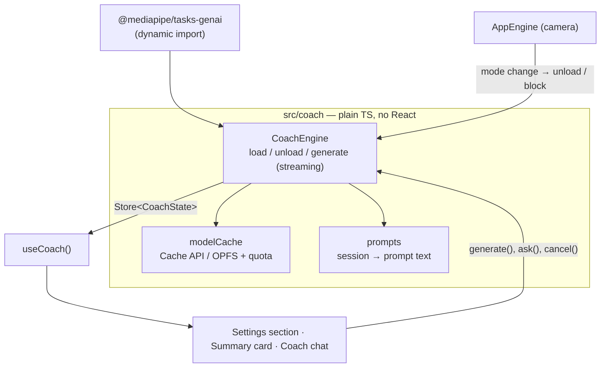

# AI Coach Plan — on-device LLM with `@mediapipe/tasks-genai`

Add an **optional, opt-in "AI coach"** that runs a Gemma model fully in the browser (WebGPU) to give natural-language feedback and help. Rep counting and form checking stay on the existing pose engine — the LLM only _talks about_ data the app already measured.

---

## 1. Goals & non-goals

**Goals**

- Friendly, personalised feedback after a workout, built from real numbers (reps, form score, partial reps, tempo).
- A chat to ask training/form questions with the user's recent history as context.
- Stay 100% on-device and private; no server, no API keys.
- Zero cost for users who don't opt in (no download, no bundle growth).

**Non-goals**

- Replacing rep counting / form checks with the LLM (too slow and unreliable for per-frame work).
- Medical or injury advice.
- Running the LLM _during_ a live set (GPU is needed for pose tracking).

---

## 2. Constraints that shape the design

| Constraint                                                                           | Impact                                                                         |
| ------------------------------------------------------------------------------------ | ------------------------------------------------------------------------------ |
| Needs **WebGPU** (Chrome / Edge; limited Safari/Firefox)                             | Feature-detect `navigator.gpu`; hide/disable otherwise                         |
| Models are **hundreds of MB to several GB**                                          | Explicit opt-in, size warning, progress bar, persistent cache, delete option   |
| Only **GPU-backend web models** (`-web.task`, `-web.litertlm`, `-gpu.litertlm`) work | Curate a short model list                                                      |
| Gemma weights on Hugging Face are often **gated** (login + accept licence)           | Browser can't always download anonymously → support **"load model from file"** |
| GitHub Pages max file size 100 MB                                                    | Can't self-host the model on Pages                                             |
| LLM + pose model compete for **GPU memory**                                          | Never run both at once; unload LLM before camera modes (configurable)          |
| Package is **beta**                                                                  | Pin exact version; isolate behind one module                                   |

---

## 3. Architecture

Same two-layer pattern as the rest of the app (engine outside React, stores → hooks → screens).



- `@mediapipe/tasks-genai` is **dynamically imported** only when the coach is enabled → main bundle unchanged.
- GenAI WASM files are **self-hosted** like the vision ones (extend `scripts/copy-wasm.mjs`).
- `CoachState`: `unsupported | disabled | downloading(progress) | loading | ready | generating | error`.
- Generation is **streamed** token-by-token into the store so the UI updates live; a **Cancel** button stops it.

### New files (planned)

```
src/coach/
  coachEngine.ts     load/unload model, generate with streaming, cancel, GPU coordination
  modelCache.ts      download with progress, Cache API / OPFS storage, quota check, delete
  models.ts          curated model list (id, label, size, url, multimodal?)
  prompts.ts         system prompt + builders: session summary, chat context, JSON tasks
  capability.ts      WebGPU + storage checks
src/hooks/useCoach.ts
src/components/CoachFeedbackCard.tsx
src/screens/CoachScreen.tsx          (chat)
```

---

## 4. Feature phases

### C1 — Foundation

- [ ] Add `@mediapipe/tasks-genai` (pinned) + self-hosted WASM via `copy-wasm`
- [ ] `capability.ts`: WebGPU check, `navigator.storage.estimate()`, request `storage.persist()`
- [ ] `models.ts`: curated list (start with smallest Gemma web model as default)
- [ ] `modelCache.ts`: download with progress → cache; **load from local file** option; delete model
- [ ] `coachEngine.ts`: lazy import, load/unload, streaming `generate`, cancel
- [ ] Settings → **AI coach (beta)** section: enable switch, model picker with sizes, download / load-from-file, progress, storage used, delete
- [ ] Unload/block coach while a camera mode is active

### C2 — Post-workout feedback

- [ ] `prompts.ts`: build a compact, structured prompt from `SessionRecord` (+ last few sessions of the same exercise for trend)
- [ ] `CoachFeedbackCard` on the Summary screen: "Get AI feedback" → streamed text, Regenerate, Cancel
- [ ] Optional: same card in History session details

### C3 — Ask the coach (chat)

- [ ] `CoachScreen`: message list, input, streaming replies, clear conversation
- [ ] Context: system prompt + short summary of recent history (token-budgeted)
- [ ] Suggested starter questions ("How do I improve my squat depth?")
- [ ] Navigation entry (see open question Q3)

### C4 — Custom exercise drafter

- [ ] In the Custom editor: "Describe it" → LLM outputs exercise JSON → `validateExercise()` → pre-fill the Advanced JSON tab for review
- [ ] Never save without user review; show validation errors

### C5 — Workout plan generator (later)

- [ ] LLM returns a plan as JSON restricted to known exercise ids → validated → shown as a list with Start buttons
- [ ] Needs a simple "routine" (multi-exercise) concept the app doesn't have yet

### C6 — Image feedback (optional, Gemma 3n multimodal)

- [ ] Capture a frame at the bottom of a rep → multimodal prompt → posture comment
- [ ] Only after C1–C3 prove stable on target devices

---

## 5. Prompting & safety rules

- System prompt: supportive gym coach, short answers, **not a medical professional**, suggest seeing a professional for pain/injury.
- Feed **facts only** (numbers from the engine); instruct the model not to invent reps or scores.
- The LLM **never changes app data**. Anything structured (C4/C5) goes through existing validators and user confirmation.
- Cap output length (`maxTokens`) and conversation length.
- Visible "AI can be wrong" note on every coach surface.

---

## 6. UX

- Settings → "AI coach (beta)" card: explains size, privacy (on-device), browser requirement; disabled with reason if WebGPU is missing.
- Download/loading shown with `LinearProgress` + MB counter; can continue browsing meanwhile.
- Coach surfaces show a clear state: _Not enabled → Enable in Settings_, _Downloading 42%_, _Ready_, _Generating…_.
- Respect reduced motion; streamed text announced politely to screen readers.

---

## 7. Risks

| Risk                                             | Mitigation                                                                   |
| ------------------------------------------------ | ---------------------------------------------------------------------------- |
| Gated model downloads fail in browser            | "Load from file" path; link to model page with instructions                  |
| Huge download on mobile data                     | Opt-in only, size shown, Wi-Fi warning                                       |
| GPU memory pressure / crashes on low-end devices | Unload before camera modes; smallest model default; catch and surface errors |
| Main-thread jank during generation               | Never generate during live tracking; evaluate Web Worker (Q4)                |
| Hallucinated or unsafe advice                    | Facts-only prompts, disclaimers, no data mutation                            |
| Beta API changes                                 | Pin version; all usage behind `coachEngine.ts`                               |
| Bundle growth                                    | Dynamic import; verify main chunk size unchanged                             |

---

## 8. Verification

- Feature fully hidden/disabled on a browser without WebGPU.
- Main bundle size unchanged with coach disabled (`npm run build` output).
- Download → reload page → model loads from cache without re-downloading.
- Starting a workout while the coach is loaded keeps pose FPS unchanged.
- Summary feedback references the actual numbers of that session.
- C4 output always passes through `validateExercise()` before it can be saved.

---

## 9. Open questions

1. **Default model** — smallest Gemma web model for reach, or a larger one for quality?
2. **Gated downloads** — OK to rely on "load from file" (user downloads from Hugging Face after accepting the Gemma licence), or do you want a hosted mirror (needs storage outside GitHub Pages)?
3. **Chat placement** — a 5th nav tab "Coach", or a floating button/dialog to keep 4 tabs?
4. **Web Worker** — run inference in a worker from the start (more work, smoother UI), or main thread first and move later if needed?
5. **Scope for v1** — ship C1 + C2 first (summary feedback only), then C3 chat?
